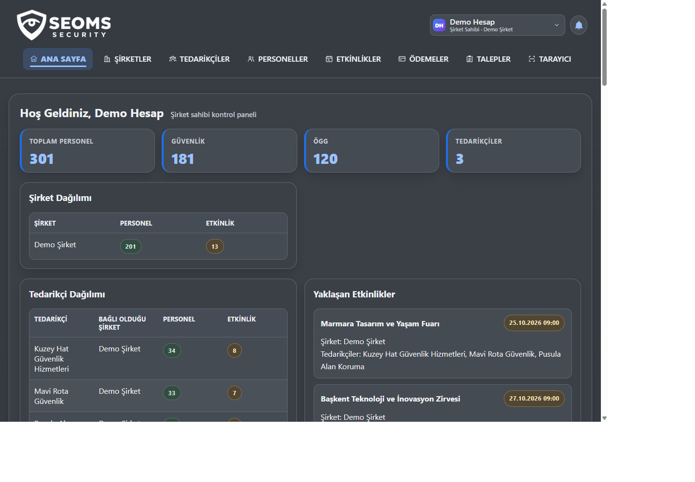
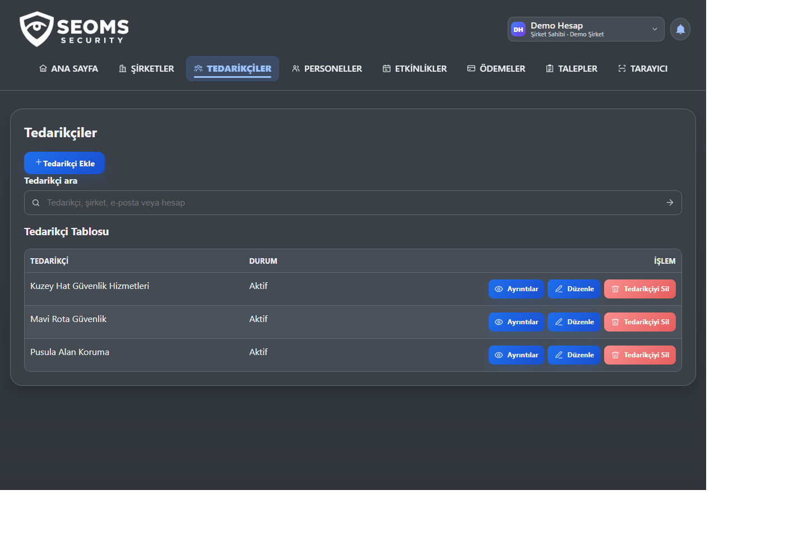
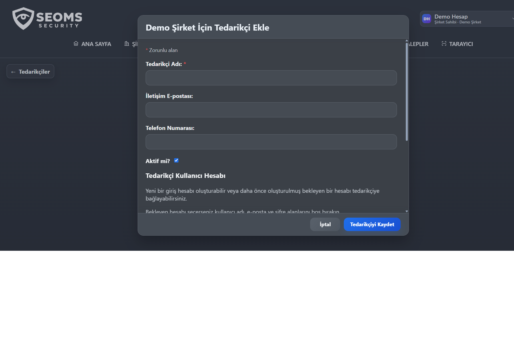
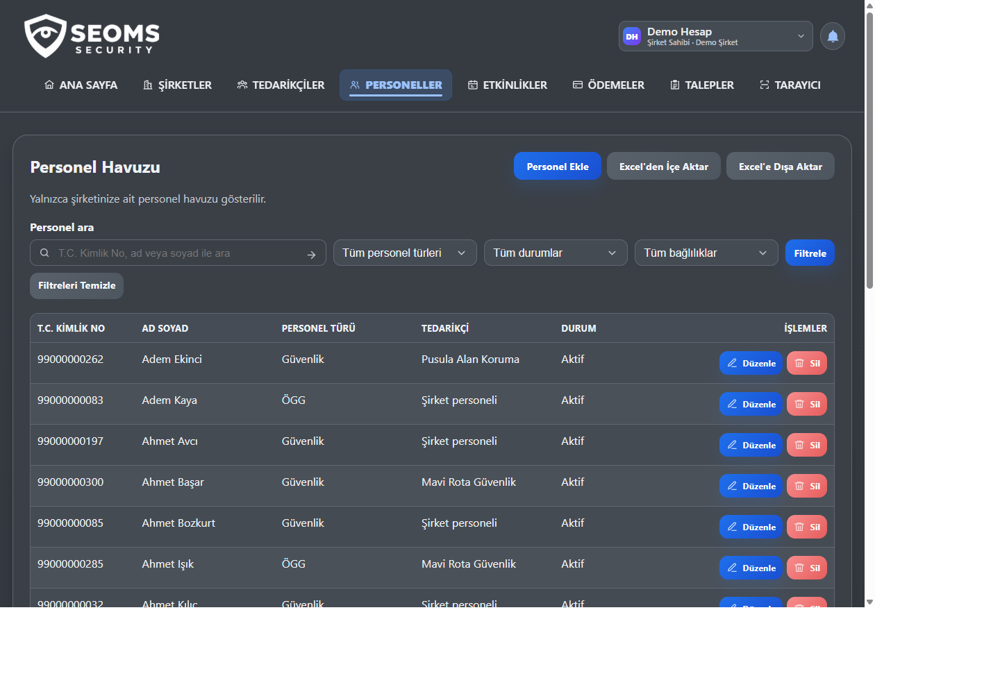
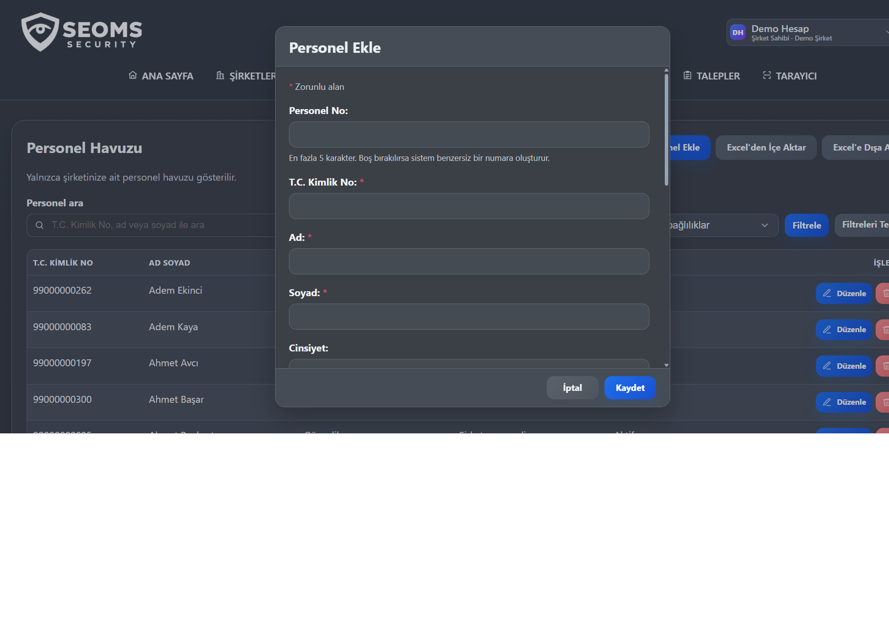
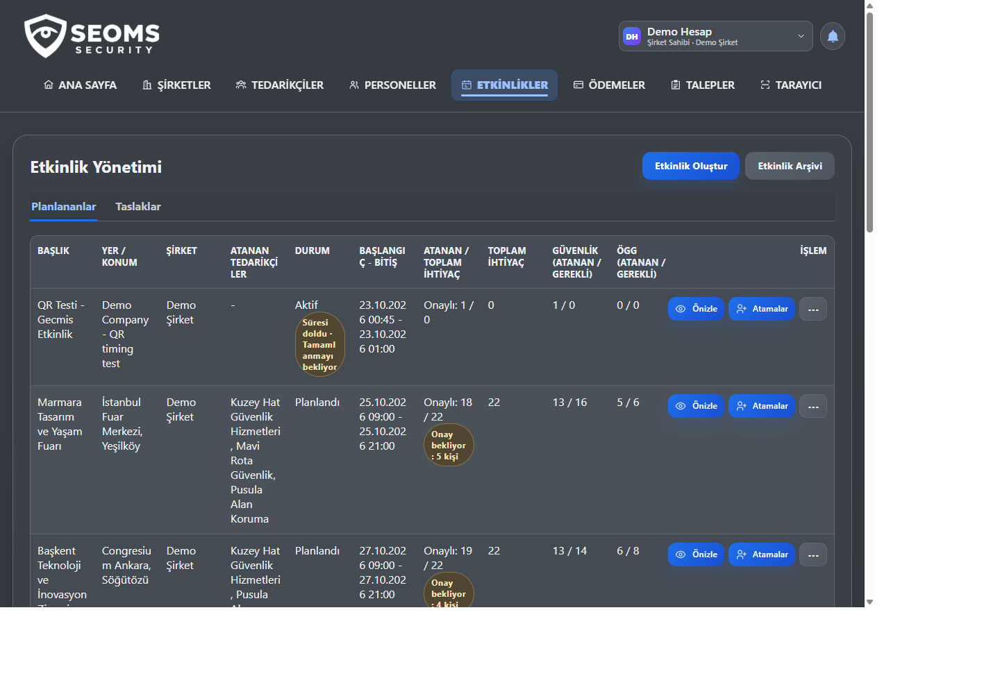
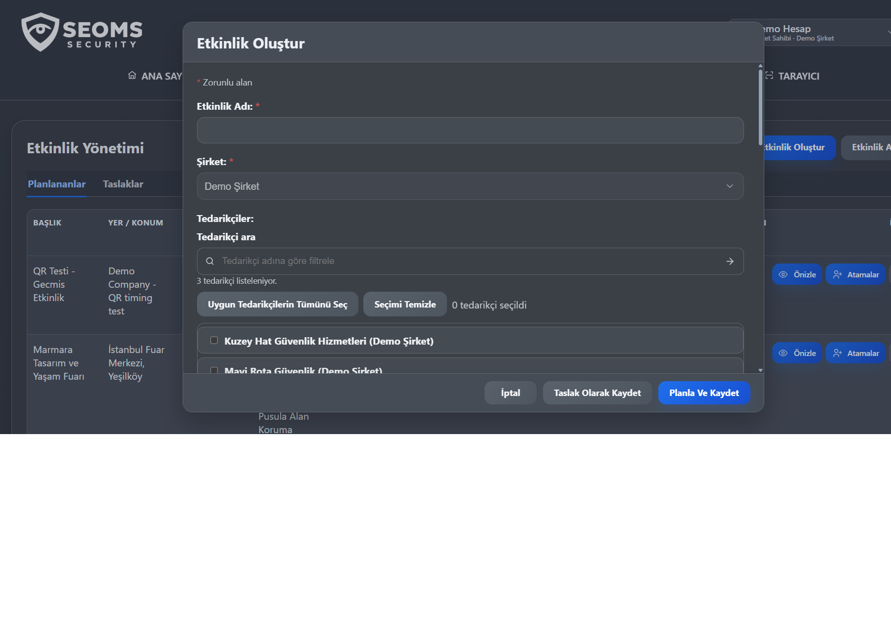
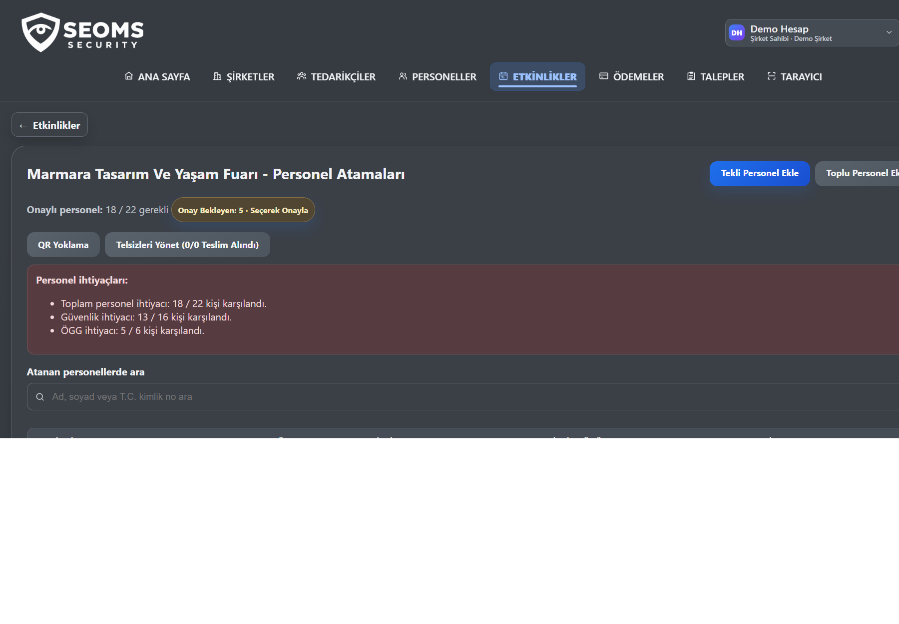
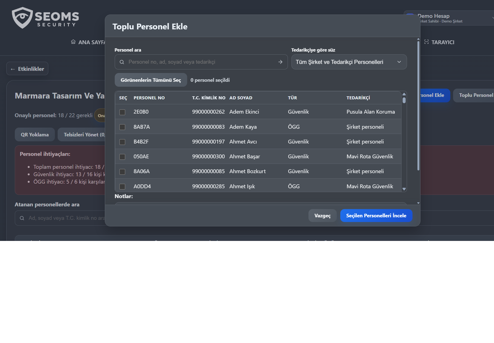
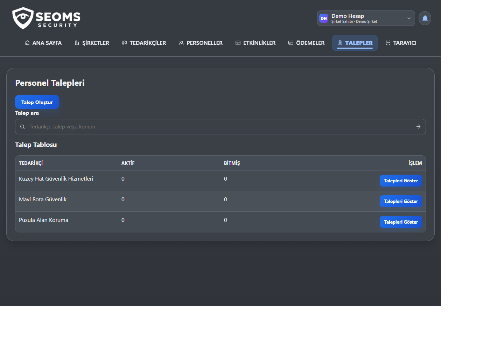

# SEOMS Security Kullanım Kılavuzu

**Sürüm:** 1.0  
**Hedef kullanıcılar:** Süper Yönetici, Şirket Sahibi ve Tedarikçi  
**Uygulama:** SEOMS Security

Bu kılavuz; uygulamada oturum açma, şirket kapsamını seçme, tedarikçi ve personel havuzlarını yönetme, etkinlik yürütme, personel talebi oluşturma ve yoklama alma adımlarını açıklar. Ekran görüntüleri, bu kılavuzun yanında bulunan `assets/screenshots/` klasöründe tutulur; uygulamanın `static/` dosyalarına dahil değildir.

> **Ekran görüntüleri hakkında:** Görseller demo hesabından alınmıştır. İsimler ve personel kayıtları örnek/demo verileridir; gerçek kullanıcı veya müşteri verisi olarak kullanılmamalıdır.

## İçindekiler

1. [Hesap rolleri](#1-hesap-rolleri)
2. [Giriş ve çalışma şirketini seçme](#2-giriş-ve-çalışma-şirketini-seçme)
3. [Gösterge panelini okuma](#3-gösterge-panelini-okuma)
4. [Şirket ve hesap yönetimi](#4-şirket-ve-hesap-yönetimi)
5. [Tedarikçileri yönetme](#5-tedarikçileri-yönetme)
6. [Personel havuzunu yönetme](#6-personel-havuzunu-yönetme)
7. [Etkinlik ve atamaları yönetme](#7-etkinlik-ve-atamaları-yönetme)
8. [Personel talebi ve tedarikçi yanıtı](#8-personel-talebi-ve-tedarikçi-yanıtı)
9. [Yoklama ve QR akışı](#9-yoklama-ve-qr-akışı)
10. [Bildirimler, ödemeler ve denetim kayıtları](#10-bildirimler-ödemeler-ve-denetim-kayıtları)
11. [Güvenli işlem ve sorun giderme](#11-güvenli-işlem-ve-sorun-giderme)

## 1. Hesap rolleri

| Rol | Neler yapabilir? |
| --- | --- |
| **Süper Yönetici** | Şirket ve hesap yönetimi yapar, çalışma şirketini seçer veya tüm şirketler görünümünü kullanır, operasyonları denetler. |
| **Şirket Sahibi** | Kendisine atanmış şirket(ler) içinde tedarikçi, personel, etkinlik, talep, atama ve yoklama işlemlerini yürütür. |
| **Tedarikçi** | Yalnızca kendi tedarikçi personelini ve kendisine atanmış etkinlik/talepleri görür; personel önerisi gönderir. Etkinlik oluşturamaz veya etkinlik bilgilerini düzenleyemez. |

Menüde görünen seçenekler, oturum açan hesabın rolüne ve seçili şirket kapsamına göre değişir. Erişim sınırları sunucuda da uygulanır.

## 2. Giriş ve çalışma şirketini seçme

1. Uygulamanın size verilen adresini açın.
2. Yönetici tarafından verilen kullanıcı adı/e-posta ve parolayla giriş yapın.
3. Birden çok şirkete erişiminiz varsa üst bölümdeki hesap/şirket seçicisinden çalışacağınız şirketi seçin.
4. Ekrandaki şirket adı ve rol bilgisini kontrol edin. İşlem yapmadan önce doğru şirketin seçili olduğundan emin olun.
5. İşiniz bittiğinde hesap menüsünden güvenli biçimde çıkış yapın.

Şirket Sahibi yalnızca hesabına atanmış şirketlere geçebilir. Tedarikçi hesabı ise bağlı olduğu kendi şirket ve tedarikçi kapsamıyla sınırlıdır.

## 3. Gösterge panelini okuma

Gösterge paneli, seçili şirkete göre özetleri ve yaklaşan etkinlikleri gösterir:

- **Toplam personel, Güvenlik ve ÖGG:** Şirket kapsamındaki personel dağılımı.
- **Tedarikçiler:** Şirkete bağlı tedarikçi sayısı ve ilgili dağılım.
- **Şirket dağılımı:** Süper Yönetici kapsamındaysa şirketler arasındaki personel ve etkinlik özeti.
- **Yaklaşan Etkinlikler:** Planlı etkinliklerin tarih, şirket ve tedarikçi bilgisi.
- **Atama Açıkları:** Etkinlik ihtiyacı ile onaylanmış personel arasındaki farkı izleme.

Kartlar kullanıcının yetkisine göre farklılaşabilir. Gösterge panelindeki sayılar operasyonel özettir; ayrıntı için ilgili menü sayfasını açın.

## 4. Şirket ve hesap yönetimi

Bu bölümdeki yönetim adımları **Süper Yönetici** yetkisi gerektirir. Şirket Sahibi kendi şirket operasyonlarını yönetir; kullanıcı hesabı veya rol oluşturamaz. Tedarikçi hesabı yalnızca bir tedarikçi kaydına bağlı olarak tanımlanır.

### Şirket ekleme

1. **Şirketler** menüsünü açın ve **Şirket ekle** seçeneğini kullanın.
2. Şirket adı, kodu ve istenen diğer şirket bilgilerini girin.
3. **Kaydet** seçeneğine basın.
4. Şirket listesinden yeni kaydı bulun, ayrıntılarını açın ve doğru şirket olduğunu kontrol edin.
5. Operasyonlara başlamak için şirketi çalışma alanı olarak seçin.

Şirketi devre dışı bırakmak veriyi tutar ancak kullanıcıların operasyonel erişimini etkiler. Şirketi kalıcı silmek ilişkili operasyon kayıtlarını etkileyebilir; kalıcı silme onayındaki etki özetini dikkatle inceleyin.

### Şirket sahibi hesabı oluşturma

1. Üst menüden **Hesaplar** bölümünü açın.
2. **Hesap oluştur** düğmesine basın. Bu ekran şirket sahibi hesabı oluşturur; tedarikçi giriş hesabı oluşturmak için tedarikçi formu kullanılır.
3. Ad, soyad, kullanıcı adı, e-posta, isteğe bağlı telefon ve ilk şifre alanlarını doldurun.
4. **Hesabı oluştur** seçeneğine basın. Yeni şirket sahibi hesabı henüz bir şirkete bağlı değilse giriş yapamaz; hesap listesinde şirket bağlantısı bekliyor olarak görünür.
5. Hesabı bir şirkete bağlama adımlarını uygulayıp erişimi etkinleştirin.
6. İlk şifreyi hesap sahibine güvenli bir kanaldan iletin; kılavuza, ekran görüntüsüne veya ortak bir belgeye yazmayın.

### Şirket sahibi hesabına şirket erişimi verme

İki yoldan birini kullanabilirsiniz:

- **Hesaplar → Şirket erişimleri:** Hesap satırında şirket sahibi erişimlerini yönetin.
- **Şirketler → ilgili şirket → Şirket erişimlerini yönet:** Bu şirkete erişecek mevcut şirket sahibi hesabını seçin.

Her iki akışta da:

1. Hesabı veya şirketi arayıp doğru kaydı seçin.
2. Eklenecek şirketi gözden geçirme adımında doğrulayın.
3. Onay ekranında hesap adı ve şirket adını kontrol edin.
4. **Erişim ver** ile işlemi onaylayın.
5. Kullanıcıya hesabından çıkıp tekrar girmesini ve doğru şirketi seçmesini bildirin.

Erişim, kullanıcı hesabından ayrı bir şirket üyeliğidir. Erişimi kaldırmak kullanıcı hesabını silmez. Son şirket erişimi kaldırılırsa hesap otomatik olarak pasifleştirilir.

### Hesapları bulma, düzenleme ve güvenliğini yönetme

**Hesaplar** listesindeki arama alanını kullanıcı adı, ad, e-posta, şirket veya tedarikçiyle kullanabilirsiniz. Hesap satırındaki işlemler:

- **Ayrıntılar:** Hesap rolünü, etkinlik durumunu ve şirket/tedarikçi bağlantılarını kontrol edin.
- **Düzenle:** Ad, soyad, kullanıcı adı, e-posta, telefon ve etkin/pasif durumunu güncelleyin. Kaydetmeden önce değişiklik özeti açılır; bilgileri kontrol edip açıkça onaylayın. Rol ve şirket/tedarikçi bağlantısı bu formdan değiştirilmez.
- **Şifreyi değiştir:** Yeni şifreyi belirleyin ve doğrulama alanlarına aynı değeri girin. Şifreyi gösteren veya yeniden görüntüleyen bir ekran yoktur; kullanıcıya güvenli şekilde iletin.
- **Şirket erişimleri:** Şirket sahibi hesaplarının erişimlerini ayrı olarak ekleyip kaldırın.
- **Hesabı sil:** Giriş hesabını kalıcı olarak siler; erişim kaldırma ile aynı işlem değildir. Onay ekranındaki sonucu incelemeden devam etmeyin.

İşlem sonrası hesap türünü ve bağlı olduğu şirket/tedarikçi bilgisini tekrar kontrol edin. Süper Yönetici hesabı normal hesap silme akışıyla silinemez.

## 5. Tedarikçileri yönetme

Şirket Sahibi, yalnızca aktif şirketine bağlı tedarikçileri yönetir. Süper Yönetici şirket seçimine göre tedarikçi kapsamını görüntüler.

### Tedarikçi ekleme

1. **Tedarikçiler** menüsünü açın.
2. **Tedarikçi Ekle** düğmesini seçin.
3. Tedarikçi adı, iletişim e-postası ve telefon gibi bilgileri girin; şirket sahibi hesabında şirket aktif çalışma alanından alınır.
4. Tedarikçi giriş hesabını aynı akışta oluşturmak için kullanıcı adı, hesap e-postası ve ilk şifreyi girin.
5. Daha önce **Hesaplar** bölümünde hazırlanmış, tedarikçiye bağlanmamış bekleyen hesap varsa onu arayıp seçin. Bekleyen hesabı seçtiğinizde yeni hesap alanlarını boş bırakın.
6. **Tedarikçiyi Kaydet** düğmesine basın.
7. Tedarikçi listesinde tedarikçi adını ve bağlı giriş hesabını doğrulayın. Yeni tedarikçi kullanıcısına ilk şifreyi güvenli biçimde iletin.

### Tedarikçiyi bulma veya güncelleme

- Arama alanında tedarikçi adı, şirket, e-posta veya hesap bilgisiyle arayın.
- **Ayrıntılar** ile ilişkili hesapları ve kayıt bilgilerini kontrol edin.
- **Düzenle** ile gerekli alanları güncelleyin; varsa kaydetme öncesi özet penceresini inceleyin.
- Tedarikçinin hesabı ayrı bir kullanıcı girişi olsa da bu düzenleme akışında tedarikçi adı ve hesap bağlantısını birlikte görebilirsiniz. Şifre değiştirilmeyecekse şifre alanını boş bırakın.
- Tedarikçi silme işlemi bağlı personel, hesap, talepler ve atamalar gibi verileri etkileyebilir. Silme onay ekranındaki etki özetini dikkatle incelemeden onaylamayın.

## 6. Personel havuzunu yönetme

Personel havuzu şirket personelini ve şirkete bağlı tedarikçilerin personelini tek ekranda ilişki bilgisiyle gösterir.

### Personel ekleme

1. **Personeller** menüsünü açın.
2. **Personel Ekle** düğmesine basın.
3. İsteğe bağlı personel numarası girin (en fazla 5 karakter); boş bırakırsanız sistem benzersiz numara üretir.
4. T.C. kimlik numarası, ad ve soyadı girin. Personel türünü **Güvenlik** veya **ÖGG** olarak seçin; cinsiyet ve iletişim alanlarını gerekiyorsa doldurun.
5. Kayıt doğrudan şirkete ait olacaksa şirket personeli olarak bırakın. Tedarikçi personeliyse doğru tedarikçiyi seçin.
6. **Kaydet** düğmesine basın ve yeni kaydın listede doğru bağlılıkla göründüğünü kontrol edin.

Tedarikçi hesabı yalnızca kendi personel kayıtlarını yönetebilir. Personel kayıtları giriş hesabı değildir.

### Personeli bulma, düzenleme ve durumunu yönetme

- Ad, soyad veya T.C. kimlik numarasıyla arama yapın.
- Personel türü, durum ve bağlılık filtrelerini seçip **Filtrele** düğmesine basın.
- Filtrelerden vazgeçmek için **Filtreleri Temizle** seçeneğini kullanın.
- İlgili satırda **Düzenle** seçeneğini kullanın. Kaydetmeden önce şirket/tedarikçi, personel türü ve güncellenen bilgileri kontrol edin.
- Çalışmayan personeli kaldırmak için mümkünse durumunu pasif veya arşivlenmiş yapın; bu, geçmiş atama kayıtlarının izlenebilirliğini korur.
- Ataması bulunan personel kaydı doğrudan silinemeyebilir. Önce etkinlik atamalarını ve geçmişi kontrol edin. Etkinlikten atamayı kaldırmak personel havuzundaki kişiyi silmez.

### Arama, filtreleme ve dışa aktarma

- Arama ve filtreleme birlikte kullanılabilir; filtreleri uyguladıktan sonra sonuç listesini kontrol edin.
- Excel'e aktarma, mevcut arama ve filtre kapsamını kullanabilir. Dışarı aktarmadan önce şirket ve tedarikçi kapsamını doğrulayın.
- İndirilen dosyada kimlik ve iletişim bilgileri bulunabileceğinden dosyayı güvenli saklayın ve yalnızca yetkili kişilerle paylaşın.

### Excel ile içe aktarma

1. **Excel'den İçe Aktar** ekranını açıp şablonu indirin.
2. Şablondaki sütunları koruyun; her satıra bir personel girin.
3. Şirket/tedarikçi havuzunu ve varsayılan personel türünü seçin.
4. Dosyayı yükleyip doğrulama önizlemesini kontrol edin.
5. Hatalı veya yinelenen satırları düzelttikten sonra aynı dosyayı yeniden seçerek aktarımı onaylayın.

Dosya en fazla 5 MB ve 5.000 satır olabilir. Aynı T.C. kimlik numarası ikinci kez içe aktarılmaz. Gerçek kişisel verileri demo ortamında veya onaysız paylaşım kanallarında kullanmayın.

## 7. Etkinlik ve atamaları yönetme

### Etkinlik oluşturma

1. **Etkinlikler** menüsünden **Etkinlik Oluştur** seçeneğini açın.
2. Etkinlik adı, şirket, konum, açıklama, başlangıç ve bitiş zamanını doldurun.
3. Gerekiyorsa hizmet verecek tedarikçileri arayıp seçin. Şirket sahibi için şirket kapsamı sabittir; tedarikçiler etkinlik oluşturamaz.
4. **Personel gereksinimleri** bölümünde Güvenlik ve ÖGG türleri için gereken kişi sayılarını girin.
5. Etkinlik hazırsa **Planla ve kaydet**, daha sonra tamamlanacaksa **Taslak olarak kaydet** düğmesini seçin.
6. Planlanmış/taslak sekmesinde yeni kaydı açıp şirket, tarih aralığı, tedarikçiler ve kişi ihtiyacını doğrulayın.

Planlananlar ve Taslaklar ayrı sekmelerde bulunur. Tamamlanan, ertelenen ve iptal edilen kayıtlar arşiv alanında görüntülenir.

### Etkinliği güncelleme ve durumunu takip etme

1. **Planlananlar** veya **Taslaklar** sekmesinde etkinliği bulun.
2. Satırın işlem menüsünden **Önizle** veya **Düzenle** seçeneğini açın. Taslak bir etkinliği düzenleyip **Planlamaya al** ile yayımlayabilirsiniz.
3. Tarih, personel ihtiyacı veya tedarikçi değişikliğini kaydetmeden önce gözden geçirin.
4. İhtiyaca göre etkinlik menüsündeki **Ertele**, **İptal et** veya **Tamamla** akışını kullanın. Erteleme/iptal gerekçesini girin. Tamamlama sırasında gelir ve yoklama/atama kontrolleri istenir.
5. Sonuçlanan kayıtları **Etkinlik arşivi** içindeki Tamamlanan, Ertelenen veya İptal edilen sekmelerinden bulun.

Tamamlanan etkinlikler finansal kayıt ve geçmiş operasyon oluşturur; tamamlandıktan sonra atama ve temel etkinlik alanları değiştirilemez. Kalıcı silme işlemi geçmiş verileri etkileyebilir; mümkünse silme yerine doğru durum akışını kullanın.

### Personel atama

1. İlgili etkinlik satırında **Atamalar** seçeneğini açın.
2. Personeli tek tek eklemek için **Tekli Personel Ekle**, çoklu seçim için **Toplu Personel Ekle** düğmesini seçin.
3. Personel numarası, ad, soyad veya tedarikçiyle arayın; tedarikçi filtresini kullanın.
4. Toplu atamada uygun personelleri işaretleyin. Görünenleri topluca seçerken seçili kişi sayısını ve listeyi mutlaka kontrol edin.
5. **Seçilen Personelleri İncele** adımında etkinliği, personelleri ve notları gözden geçirin.
6. Son onayı verdikten sonra atama tablosunda onay durumunu ve onaylı/toplam ihtiyaç sayaçlarını doğrulayın.

### Atamaları ve bekleyen önerileri yönetme

- Atama listesindeki **Onay Bekleyen** sayacını açarak tedarikçi önerilerini inceleyin. Doğru personeli seçip tek tek veya toplu onaylayın; reddedilen öneri atanmış personel olmaz.
- Atama satırından yoklamayı, gerektiğinde yedek personel işlemini ve izin verilen diğer durum güncellemelerini yapın.
- Atama satırından personeli etkinlikten çıkarmak ilgili atama kaydını etkiler; personel havuzunu silmez.
- Tedarikçi personel önerisi gönderdiğinde öneri onay bekler; şirket yetkilisi onaylamadan etkinliğe kesin atama yapılmaz.
- Uygun olmayan, pasif, aynı saat aralığında başka etkinliğe atanmış veya farklı şirket/tedarikçi kapsamındaki kayıtlar reddedilebilir. İhtiyaç sayısı aşılırsa uygulama uyarı gösterir.
- Tamamlanmış, iptal edilmiş veya ertelenmiş etkinliklerde atama işlemleri kısıtlanır.

## 8. Personel talebi ve tedarikçi yanıtı

Talep akışı şirket ve tedarikçi hesapları arasında personel ihtiyacını, yanıtları ve öneri onaylarını takip eder.

### Şirket yetkilisi: talep oluşturma

1. **Talepler** menüsünü açın ve **Talep Oluştur** düğmesini seçin.
2. Aktif şirketinizin tedarikçisini ve o tedarikçiye atanmış etkinliği seçin.
3. Tarih, konum, Güvenlik/ÖGG sayısı ve açıklamayı girin.
4. Talep özetini kontrol edip gönderin.
5. Tedarikçi yanıtını ve personel önerilerini aynı talep ekranından takip edin.

Tamamlanmış, ertelenmiş veya iptal edilmiş etkinlikler yeni talep oluşturma seçeneklerinde yer almaz.

### Tedarikçi: yanıt ve personel önerisi

1. **Talepler** ekranında kendi tedarikçinize gelen talebi açın.
2. Talebi kabul edin veya reddedin.
3. Kabul edilen talep için yalnızca kendi aktif ve uygun personelinizden, istenen tür ve kalan sayı sınırları içinde seçim yapın.
4. Personel önerisini gönderin. Öneri şirket yetkilisinin onayına gider; gönderilmesi personeli etkinliğe otomatik olarak atamaz.

### Şirket yetkilisi: önerileri inceleme

1. Talepteki bekleyen personel önerilerini açın.
2. Her öneride personelin kimliğini, personel türünü ve tedarikçi bağlantısını kontrol edin.
3. Önerileri tek tek veya seçili kayıtları topluca onaylayın.
4. Onaylanan personelin etkinlik atama listesine eklendiğini doğrulayın.

Talep, istenen personel önerileri onaylanıp etkinliğe atandığında tamamlanabilir. Bir talebi iptal etmek, bekleyen önerileri ve talep üzerinden oluşturulan atamaları etkileyebilir; onaydan önce ekrandaki bilgileri okuyun.

## 9. Yoklama ve QR akışı

### Manuel yoklama

1. Etkinlikte **Atamalar** ekranını açın.
2. İlgili personel için **Geldi** veya **Gelmedi** durumunu seçin.
3. Kaydın tabloda ve sayaçlarda güncellendiğini doğrulayın.

Gelmeyen personel aktif atama sayısından çıkar. Gerekirse aynı türde ve uygunluk koşullarını sağlayan bir yedek personel atanabilir.

### QR ile yoklama

QR kullanımı iki ekrandan oluşur:

1. **Personel**, `/qr-create/` adresinde T.C. kimlik numarasını ve kayıtlı telefon numarasını doğrular, uygun etkinliğini seçerek geçici QR üretir.
2. Yetkili, etkinliğin **Atamalar → QR Yoklama** penceresinden kamerayı açıp QR kodu okutur.
3. Etkinliğin yoklama modu yönetici onaylıysa tarama sonucunu ayrıca onaylayın. Otomatik modda geçerli tarama yoklamayı anında kaydeder.
4. Sonucun etkinlik ve personel için doğru olduğunu kontrol edin.

QR kodu kısa süreli ve tek kullanımlıktır. Portalda SMS gönderilmez; telefon numarasının kayıtla eşleşmesi SMS doğrulaması anlamına gelmez. Kamera erişimi için HTTPS veya yerel geliştirmede `localhost` kullanın. QR kodunu başkasına göndermeyin veya ekran görüntüsünü paylaşmayın.

## 10. Bildirimler, ödemeler ve denetim kayıtları

### Bildirimler

- Üst menüdeki zil, okunmamış bildirim sayısını gösterir.
- Bildirimler; yeni personel talepleri, talep yanıtları, tedarikçi personel sunumları ve atama onayları için oluşturulabilir.
- Zile veya **Bildirimler** sayfasına girerek kaydı açın; bağlantı varsa ilgili talep/etkinliğe yönlendirilirsiniz.
- Bildirimleri okundu işaretleme veya silme işlemini yalnızca doğru şirket/tedarikçi kapsamındayken yapın.

### Ödemeler

**Ödemeler** ekranı tamamlanmış etkinliklere dayalı personel ödeme dökümlerini gösterir. Hesaplamalar kaydedilmiş katılım ve etkinlik günlerine bağlıdır. Excel dosyasını indirmeden önce etkinliği ve personel kapsamını kontrol edin; IBAN ve ödeme dosyalarını güvenli kanallarda saklayıp paylaşın.

### Denetim kayıtları

Yetkili yöneticiler **Denetim Kayıtları** ekranından kritik işlemleri inceleyebilir. Kayıtlar işlemi yapan hesabı, zamanı, nesneyi ve hassas olmayan ilgili ayrıntıları içerir. Bu ekranı personel veya ödeme verilerini dışarı aktarmak için kullanmayın.

## 11. Güvenli işlem ve sorun giderme

### Kaydetme veya filtreleme beklediğiniz gibi çalışmıyor

- Filtre alanlarını seçtikten sonra **Filtrele/Uygula** düğmesine basın.
- Beklenen şirketin üst bölümde seçili olduğunu doğrulayın.
- Tedarikçi hesaplarında yalnızca kendi kapsamınızdaki kayıtların görünmesi normaldir.
- Kaydetme onay penceresi açıldıysa bilgileri kontrol edip açıkça onaylayın; vazgeçmek için **Vazgeç/Geri dön** seçin.

### Kayıt listede görünmüyor

- Arama metnini ve filtreleri temizleyin.
- Durum sekmesini (Planlananlar/Taslaklar/Arşiv) kontrol edin.
- Şirket sahibi hesabında doğru şirketin seçili olduğundan emin olun.
- Tedarikçi hesabında kayıt şirket tarafından size atanmış olmalıdır.

### Kamera açılamıyor veya QR okunmuyor

- Siteyi HTTPS ya da `localhost` üzerinden açın ve tarayıcı kamera iznini verin.
- QR'ın güncel, doğru etkinliğe ait ve süresi geçmemiş olduğunu doğrulayın.
- Her QR tek kullanımlıdır; daha önce okutulduysa personelden yeni QR üretmesini isteyin.
- Kamera iznini açamıyorsanız manuel yoklama akışını kullanın.

### Silme veya değiştirme işlemi

- Silme işlemlerinde etki özeti ve onay penceresini okuyun.
- Personel ataması bulunan personeli doğrudan silemeyebilirsiniz; pasife alma/arşiv seçeneklerini değerlendirin.
- Emin değilseniz onayı iptal edin ve yöneticinizle doğrulayın.
- Şifre, T.C. kimlik numarası, IBAN, QR kodu veya oturum bilgilerini ekran görüntüsüyle paylaşmayın.

---

Bu kılavuz son kullanıcı iş akışlarını açıklar. Ekranların adları ve izinler dağıtım ayarlarına, hesaba ve seçili şirkete göre farklılık gösterebilir. Sistem yöneticinizin verdiği şirket içi prosedürler ve veri koruma kuralları önceliklidir.
